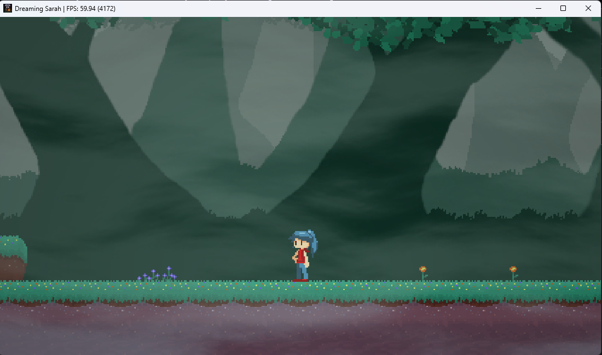
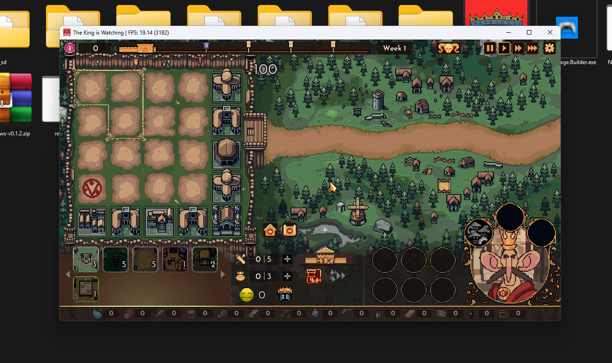

# Relinker Runner

A single double-click `.bat` file that converts a game's `eboot.bin.esbak` into a Windows executable (`app.exe`) using `relinker`.

When you open `relink.bat` it looks for a `source` folder next to it:

- **No `source` folder found** → prints an error and stops.
- **`source` folder found** → it does *not* enter the folder; it runs the commands from the parent folder:

```powershell
Copy-Item ".\source\eboot.bin.esbak" ".\source\input.elf"
.\relinker-v0.1.2.exe --windows source\input.elf app.exe
```

(The `.bat` uses the equivalent `copy` command, so no PowerShell or execution-policy setup is needed.)

## Requirements

You **must** download these:

1. **AnyPS5 PRX package (Windows)**: [prx-windows-v0.1.2.zip](https://github.com/boykopovar/AnyPS5/releases/download/v0.1.2/prx-windows-v0.1.2.zip) (release page: https://github.com/boykopovar/AnyPS5/releases/tag/v0.1.2)
2. **relinker**: [relinker-v0.1.2.exe](https://github.com/boykopovar/AnyPS5/releases/download/v0.1.2/relinker-v0.1.2.exe)
3. **A game you own.**
4. **Windows**.
5. **Python 3 + `unwrap_self.py`** (only needed when your game has `eboot.bin` but no `eboot.bin.esbak`, see below).

Recommended (not required):

- **exFAT format + exFAT Image Builder**: https://github.com/kerrdec97/ps5-exfat-builder. Using an exFAT game image extracted with this tool is the **preferred** way. If you don't have the game as exFAT, you can use the game files normally (see Setup, Step 1, Option B).

## 🎬 Video Tutorial

Watch the full tutorial for this tool here: **https://gofile.io/d/kVDY6oyP**

## Setup

### Step 1: Get the game files into a `source` folder

**Option A (recommended): exFAT + exFAT Image Builder**

1. Open **exFAT Image Builder**.
2. Go to the **Extract** tab.
3. Select your game's **exFAT image** and **extract** it.
4. Extract the output **into a folder named `source`** (create it first if needed).

**Option B: regular game files (exFAT is not required)**

1. Create a folder named **`source`**.
2. Put your game files directly inside it.

Either way, when you're done `source` should contain the game files, including `eboot.bin.esbak` (or `eboot.bin`).

### Step 2: Download the AnyPS5 PRX package

1. Download [`prx-windows-v0.1.2.zip`](https://github.com/boykopovar/AnyPS5/releases/download/v0.1.2/prx-windows-v0.1.2.zip) and **extract it next to the `source` folder** (same parent folder, not inside `source`).

### Step 3: Create `app0`

1. Create a new folder named **`app0`** next to the `source` folder.
2. **Copy** (don't move) everything that is inside `source` into `app0`.

### Step 4: Add relinker and the runner

1. Download [`relinker-v0.1.2.exe`](https://github.com/boykopovar/AnyPS5/releases/download/v0.1.2/relinker-v0.1.2.exe) and put it next to the `source` folder.
2. Put `relink.bat` next to the `source` folder as well.

## Unwrapping `eboot.bin` (SELF → ELF)

`relinker` needs a plain **ELF**. If your game has `eboot.bin.esbak`, that file is already an ELF and nothing else is needed.

If there is **no** `eboot.bin.esbak`, `eboot.bin` is usually a **SELF container**, and relinker stops with:

```
FAIL: The input is a SELF container, not an ELF
```

To fix it:

1. Install **Python 3** (https://www.python.org/downloads/ ; tick *Add python.exe to PATH*).
2. Get `unwrap_self.py` from the `tools` folder of the AnyPS5 repo: https://github.com/boykopovar/AnyPS5 and put it in a folder named `tools` next to `source`.
3. Run `relink.bat` again. It runs `unwrap_self.py source\eboot.bin source\input.elf` for you before calling relinker.

Notes (from the [AnyPS5 usage guide](https://github.com/boykopovar/AnyPS5/blob/main/docs/user/USAGE.md)):

- The unwrap only works on **already-decrypted** containers. It refuses containers whose segments are encrypted.
- Other bundled modules (`.prx` files in `sce_module/` or `prx/`) that are SELF containers are **skipped with a warning** ("Skipping SELF container ..."). That warning is not what makes relinker fail, but if you want them included they must be unwrapped too. See the usage guide.

## 🎮 Game Testing / Compatibility

Results from testing games with this tool. Only games the tester legally owns should be reported.

| Game | Version | Status | Notes | Tested by |
|---|---|---|---|---|
| Dreaming Sarah | - | ✅ Works | Tested by the author with `relink.bat` | Maintainer |
| The King is Watching | - | ✅ Works | Tested by the author with `relink.bat` | Maintainer |

**Status legend:** ✅ Works · ⚠️ Partial (runs with problems) · ❌ Doesn't work

### Screenshots

<table>
  <tr>
    <td align="center" width="50%">
      <br>
      <b>Dreaming Sarah</b>
    </td>
    <td align="center" width="50%">
      <br>
      <b>The King is Watching</b>
    </td>
  </tr>
</table>

### Tested a game?
[Open a game test report](../../issues/new?template=game-test-report.md) and include the game name, version, result, and the text from the `relink.bat` window. Confirmed results get added to the table above.

## Expected folder layout

```
MyGame/
├── source/
│   └── eboot.bin.esbak          (+ the rest of the game files)
├── app0/
│   └── ...                      (a copy of everything inside source)
├── (extracted contents of prx-windows-v0.1.2.zip)
├── tools/
│   └── unwrap_self.py           (only needed if there is no eboot.bin.esbak)
├── relinker-v0.1.2.exe
└── relink.bat
```

## Usage

Double-click **`relink.bat`**. The window stays open at the end so you can read the result.

To run it on a different folder, open `cmd` and pass the path:

```bat
relink.bat "D:\Games\MyGame"
```

## What it does

1. Checks that the folder exists.
2. Looks for a `source` folder. If it is missing, it shows an error and stops.
3. Looks for `source\eboot.bin.esbak`. If it's missing, it looks for `source\eboot.bin` instead. If neither exists, it shows an error and stops.
4. Checks that `relinker-v0.1.2.exe` exists.
5. Creates `source\input.elf`:
   - from `eboot.bin.esbak`: a plain copy.
   - from `eboot.bin`: unwraps it with `tools\unwrap_self.py` (needs Python); if the tool or Python is missing, or the unwrap fails, it falls back to a plain copy.
6. Runs `relinker-v0.1.2.exe --windows source\input.elf app.exe`.
7. `app.exe` is created in the same folder.

## Troubleshooting

| Problem | Fix |
|---|---|
| `No "source" folder found` | Put `relink.bat` in the folder that *contains* `source`, not inside `source`. |
| `Neither eboot.bin.esbak nor eboot.bin was found` | Make sure the game files are *directly* inside the `source` folder (not in a sub-folder). If you use exFAT, re-check that you used the **Extract** tab in exFAT Image Builder. |
| `FAIL: The input is a SELF container, not an ELF` | `eboot.bin` must be unwrapped first. See [Unwrapping `eboot.bin`](#unwrapping-ebootbin-self--elf). Needs Python 3 and `tools\unwrap_self.py`. |
| `relinker-v0.1.2.exe was not found` | Download it from the Requirements section and put it next to the `source` folder. |
| Missing PRX files / `app0` problems | Re-check Setup: the zip must be extracted next to `source`, and `app0` must contain a copy of the files from `source`. |

## Credits

- [exFAT Image Builder](https://github.com/kerrdec97/ps5-exfat-builder) by kerrdec97
- [AnyPS5](https://github.com/boykopovar/AnyPS5) by boykopovar (PRX package and relinker, v0.1.2)
